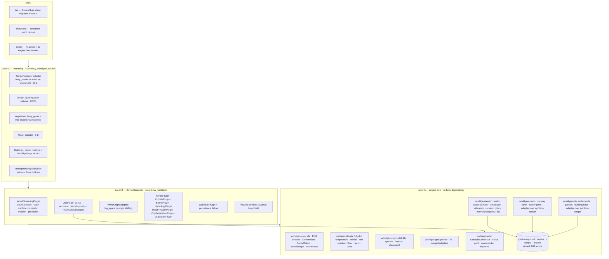

# Target architecture

Phase 1 deliverable 8. Implements ADR-001. Status key: **[exists]** provided by a verified dependency today;
**[proposal]** design not yet validated — each proposal names the spike that must validate it before it is relied on.

## 1. Layering



Rules: arrows are the only allowed dependency direction; Layer A never names Bevy types; third-party renderers
and `big_space` are reachable **only** through traits defined in B/C (`TerrainRenderer`, `VegetationRenderer`,
`WaterRenderer`, `WorldOrigin`, `JobBackend`). No crate or plugin is created without a boundary that is tested in isolation.

## 2. Data flow (one chunk, steady-state streaming)

```mermaid
sequenceDiagram
  participant Cam as Camera + velocity
  participant Plan as Plan (main, cheap)
  participant Q as JobQueue (versions, priority)
  participant W as Workers (task pool / wasm worker)
  participant Col as Collect (main, ≤1 ms/chunk)
  participant Up as Upload (budgeted bytes/frame)
  participant R as Render

  Cam->>Plan: position, velocity (predictive ring)
  Plan->>Q: request(ChunkId, Lod, version, priority)
  Q->>W: GenJob (pure, serialisable, cancelable)
  W-->>Col: GenResult{heights, normals/TBN, splat, roads, lots, instances} (Message)
  Col->>Col: drop if version stale; else set state=Ready
  Col->>Up: enqueue GPU resources
  Up->>R: Mesh/Image handles, Entity spawned (Resident)
  Plan->>Col: evict far / LOD-demote (Evicting → despawn, assets freed)
```

Chunk state machine (component `ChunkState`): `Requested → Generating(v) → Ready → Resident → Evicting`; any edit or
config change bumps `GenVersion` and re-enters `Requested`; completed jobs carrying an older version are discarded.

## 3. Schedule (explicit sets, minimal chaining)

```text
Update:   WorldSet::Observe  →  Plan  →  Dispatch  →  Collect  →  Realise  →  Upload  →  Evict
```

* `Observe` reads cameras/origin; `Plan` computes wanted chunks (pure on resources, `run_if(origin_or_config_changed)`);
  `Dispatch` spawns jobs within `WorldBudget.max_inflight`; `Collect` polls with `bevy_tasks::futures::check_ready` and
  emits `ChunkGenerated`/`ChunkFailed` **messages**; `Realise` creates components; `Upload` is byte-budgeted per frame;
  `Evict` frees assets (explicit handle lifecycle; shared meshes/materials instanced).
* Sets are for **ordering and testability**; the audit shows parallelism comes from jobs, not from system graph shape.
* Worker threads never touch the `World`. All ECS mutation happens in `Collect`/`Realise`/`Upload`.

## 4. Coordinates and large worlds

* World positions are `(CellCoord i64×2, local f32)`; Layer A functions take world metres as `f64` for sampling and
  are fed chunk-local `f32` buffers. **[exists]** `big_space` (`=0.14.0-rc.0` for Bevy 0.20) provides grid cells + floating
  origin; **[proposal]** wrap it in `WorldOrigin` and keep an origin-shift fallback so a pre-release dependency is not load-bearing.
* Chunk addressing: `ChunkId { lod, x:i32, z:i32 }`, 257² samples per terrain chunk (256 cells + shared border row), edge
  length derived from cell size; road/city tiles ≤512 cells.

## 5. Seamless terrain and erosion  **[proposal — S-2, S-3]**

* **Sampler (S-2).** Base height is a pure function `h(x_m, z_m, seed)` (continental mask → ridged multifractal mountains
  → domain warp → valleys), all transcendentals via `libm`. Adjacent chunks sample the same function on shared border
  coordinates, so borders are bitwise equal by construction (baseline: current tile-local FBM gives 58.9–117× seams).
* **Erosion (S-3).** Sequential droplet erosion mutates the field it reads, so it is order-dependent and cannot be made
  chunk-independent. Proposal: evaluate droplets against the **immutable base field** and accumulate height *deltas* in
  fixed-point (i32) buffers — addition is then associative, so a chunk plus an apron of `max_steps × step` cells reproduces
  exactly the contribution any neighbour would compute. Droplets are seeded by hash of their spawn *world cell*, so any chunk
  can regenerate the droplets that reach it. Acceptance: border bitwise equality and request-order independence; visual
  comparison against sequential erosion to confirm the look is acceptable. Fallback: coarse regional simulation +
  `bevy_erosion_filter` for fine detail.
* **Hydrology.** Regional (coarse, e.g. 8–32 m cells over super-tiles of several km) flow accumulation yields rivers/lakes
  that chunks consume as constraints (carve + water bodies). Cached per region; deterministic.

## 6. Roads and cities  **[proposal — S-5, S-7]**

* **Highway layer:** least-cost paths over a coarse cost surface (slope, water, biome) produce spline graphs per region;
  grades and bridge/tunnel decisions are made here (the Lab has no bridges/tunnels).
* **Tile roads:** `symbios-tensor` per tile (≤512 cells; measured 86 ms) with the highway graph injected as fixed edges
  and `KeepOut` discs (**[exists]** in `TensorConfig`). Neighbouring tiles connect through deterministic **border ports**
  (positions derived from hash(edge id, seed)), solving the documented "streamlines do not cross tile borders" gap.
* **Settlements:** suitability field (flat, near water/highways) places towns; city tiles use the same tile pipeline.
* **Buildings:** CGA derive in workers (0.094 ms each); **bake** terminals to per-building meshes grouped by material;
  far LODs via `VisibilityRange`/impostors. Budget: ≤ 20 entities per building at LOD0 (Lab today: ≈385).

## 7. Rendering strategy (Bevy-first)

| Concern | Choice | Notes |
|---|---|---|
| Lighting, shadows, tonemapping, TAA, SSAO, SSR, bloom | Bevy built-ins | **[exists]** |
| Sky / aerial perspective / volumetric fog | Bevy `atmosphere` + fog | **[exists]**; Overlands' sky/cloud WESL (Apache-2.0) as optional reference |
| Occlusion culling | Bevy `OcclusionCulling` | **[exists]**; **verify** it works with custom terrain materials (spike) |
| HLOD | Bevy `VisibilityRange` | **[exists]** |
| Terrain geometry/LOD | S-1 | `mate-h/bevy_terrain` (quadtree, morph, deferred) vs in-house geomipmapped chunks with skirts |
| Terrain shading | `ExtendedMaterial` splat (Lab's WESL, modernised): ≥ 8 layers, climate-driven weights, triplanar on slopes, distance-faded detail, wetness | **[exists]** pattern |
| Detail erosion | `bevy_erosion_filter` as displacement/normal detail | **[exists]**, MPL-2.0 unmodified |
| Vegetation | `bevy_grass` (grass/flowers) + instanced trees with LOD/impostors | grass **[exists]**; trees **[proposal]** |
| Water | S-8 | `bevy-aqua` vs custom (depth fog, refraction, foam, shoreline, flow) |
| Meshlets / Solari | optional presets only | experimental / hardware-gated |
| Upstream contributions | only when a spike exposes a general gap (terrain + `OcclusionCulling`, tangent job guidance, docs) | no private renderer fork |

## 8. Determinism contract

| Level | Guarantee | How it is enforced |
|---|---|---|
| D1 | Same seed + config + crate versions + target ⇒ **bitwise identical** chunk output, independent of request order, thread count, and chunk neighbours | golden FNV/BLAKE hashes per `(chunk, subsystem)` in CI; permutation tests (verified for the existing tile primitive) |
| D2 | Same across native targets (x86_64, aarch64) and wasm32 | `libm` for transcendentals, no `f32::sin/exp/powf`, fixed-point for cross-chunk accumulation, no hash-map iteration order dependence, no float reductions with scheduler-dependent order; **golden-hash CI on wasm32** (S-6) |
| D3 | Same across crate/major versions | **not promised**; generator version is part of the world file |

RNG: `RegionRng(seed, SubsystemId, ChunkId[, EntityId])` via SplitMix64 derivation (**[exists]**: `derive_tile_seed`),
never a shared stream. The existing libraries satisfy D1 on one machine (**measured**); D2 is currently *argued, not measured* by upstream.

## 9. Memory and asset lifecycle

`WorldBudget { cpu_mb, gpu_mb, max_inflight_jobs, upload_bytes_per_frame, resident_chunks_per_lod }`. Asset rules: one
`Mesh` per resident chunk-LOD (freed on eviction), pooled index buffers, shared materials, texture arrays for splat layers,
LRU caches (the Symbios `ShapeMeshCache` is a good model **[exists]**). Persistent edits are stored as sparse delta layers
keyed by `ChunkId` and merged at `Collect`.

## 10. Native and WebAssembly

Layer A jobs are `GenJob → GenResult` pure functions (Overlands pattern, Apache-2.0): native runs them on Bevy's task pool;
wasm runs them in pooled Web Workers (messages encoded with a self-describing codec — Overlands found bincode fails on
tagged enums). The main thread only receives results. WebGPU is the web target (compute-heavy renderers need it; WebGL2 is not supported by `bevy_grass`).

## 11. Testing strategy

Unit and property tests in Layer A (seam equality, order independence, monotone LOD, round-trip serialisation);
headless integration tests with `MinimalPlugins` for the streaming state machine; criterion benches mirroring
`bench/phase1-algos`; in-engine frame-time bench harness (from the instrumented-Lab patch) with CSV output; CI:
`fmt`, `clippy -D warnings`, `test`, `cargo check --target wasm32-unknown-unknown`, `cargo deny`, golden-hash job.
