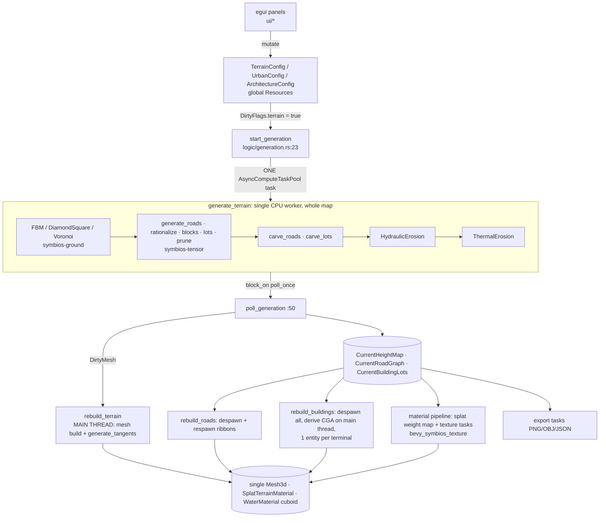

# Symbios Ground Lab — technical audit

Status: Phase 1 deliverable 2. Audited 2026-11-13/14. Every claim is tagged **[read]** (source read),
**[run]** (executed/measured here) or **[doc]** (taken from a README/docs page, not verified).
Numbers come from `docs/benchmarks/baseline.md` and the raw logs in `docs/benchmarks/raw/`.

## 0. Summary of findings

1. **Ground Lab is a thin application (6.6 k Rust LOC on the Bevy 0.20 branch) over independent,
   well-tested libraries.** The algorithms live in `symbios-ground`, `symbios-tensor`,
   `symbios-shape`, `symbios-texture` (all Bevy-free, MIT). The Lab contributes glue, egui panels,
   materials, a CGA building kit and export. **[read]**
2. **The prompt's premise is out of date in two ways.** (a) `dinosath/main` and upstream `main` are the
   same commit but target Bevy 0.18 with ancient crate versions (symbios-ground 0.2.1 …); the
   libraries are now at Bevy 0.20. (b) A local, **unpushed** branch `bevy-0.20-veilbound`
   (2 commits, author "Claude") already ports the Lab to Bevy 0.20 + current crates. That branch is what
   I built and benchmarked. **[read][run]**
3. **The data model is single-heightmap / single-mesh / global-singleton.** `CurrentHeightMap(Option<HeightMap>)`,
   one `TerrainMesh` entity, one monolithic generation task. Streaming, LOD and per-chunk jobs are not
   "missing features"; they contradict the app's core resources. **[read]**
4. **Measured scalability failures are specific and fixable, and none are in the algorithms' correctness.**
   Main-thread mikktspace tangent generation freezes the app for **5.6 s at 1025²** and **27.7 s at 2049²**;
   road *rationalization* is ≈quadratic in node count (**37.9 s at 2049²**); per-tile generation produces
   seams **59–117× larger than interior height steps**. **[run]**
5. **Rendering is the weakest layer, algorithms are the strongest.** The look is gizmo roads, a 4-layer
   splat, a sum-of-sines water cuboid and brick-textured boxes. That is an asset/rendering gap, not an
   algorithmic one (see §5; screenshot reproduced in baseline.md). **[run]**

## 1. Repository facts (re-verified, not assumed)

| Item | Value | Method |
|---|---|---|
| `dinosath/symbios-ground-lab` | fork of `TheJanusStream/symbios-ground-lab`; MIT | `gh api` |
| `main` SHA (both) | `7358b009385f67d0f65619b423c2c6933d2ae414` | `gh api …/commits/main` |
| Fork vs upstream | 0 ahead / 0 behind | `gh api …/compare` |
| Upstream history | 60 commits, 1 author, 2026-02-18 → 2026-03-21; 0 PRs, 0 releases, 0 open issues, 4 stars | `git log`, `gh api` |
| Last upstream push | 2026-03-21 (≈8 months stale at audit time) | `gh api` |
| `main` manifest | Bevy 0.18, bevy_egui 0.39, symbios-ground 0.2 … (resolves to bevy 0.18.1, symbios-ground 0.2.1, symbios-tensor 0.1.0, symbios-shape 0.1.0) | `cargo generate-lockfile` |
| Local branch | `bevy-0.20-veilbound` @ `d391473`, 2 commits ahead of `main`, **not on any remote** | `git branch -a` |
| Branch manifest | Bevy 0.20 (lock: 0.20.1), bevy_egui 0.43.1, symbios-ground 0.4.2, tensor 0.7.0, shape 0.5.0, bevy_symbios_ground 0.8.0, shape 0.11.0, texture 0.14.0 | `Cargo.toml`, `Cargo.lock` |
| `Cargo.lock` | **gitignored** (`.gitignore:5`) for an application; builds are not reproducible from the repo | read |
| CI | one workflow, `deploy.yml` (wasm build → GitHub Pages). **No fmt, clippy or test job** | read |
| Tests | 1 `#[test]` on `main`; 11 on the branch (kit layout code). Not executed by me | grep |

## 2. Layout and responsibilities (branch, 6,618 LOC + 291 WESL)

| Module | LOC | Role |
|---|--:|---|
| `core/` | 788 | Config structs and global resources (`TerrainConfig`, `DirtyFlags`, `CurrentHeightMap`, `CurrentRoadGraph`, …) |
| `logic/` | 554 | `generation.rs` (async whole-map job), `erosion_viz.rs` (step-by-step droplet visualisation) |
| `visuals/` | 2,622 | terrain mesh, splat/water materials, roads, buildings, kit buildings, street props, export (PNG/OBJ/JSON), gizmos |
| `ui/` | 1,104 | egui panels |
| `kit/` | 1,314 | facade/building kit assembler + Poly Haven glTF handling (added on the branch) |

## 3. Architecture diagram

Scheduling: one `Update` tuple of **20 systems under a single `.chain()`** (`src/main.rs:103–127`), plus a
second tuple ordered `.after(rebuild_buildings)` and an egui tuple in `EguiPrimaryContextPass`. **[read]**

## 4. Terrain subsystem (`symbios-ground` 0.4.2, 2.9 k LOC, 45 tests pass)

| Aspect | Finding | Evidence |
|---|---|---|
| Data | `HeightMap`: flat row-major `Vec<f32>`, `width × height`, `scale` world-units/cell, plus `lakes()` list. 4 B/cell. | `src/heightmap.rs` **[read]** |
| FBM | **Value noise** (not gradient/simplex), 256-entry permutation + value table, quintic fade, ≤32 octaves. Sampled at `x / w * base_frequency`: **tile-local, not world-space coordinates**. | `src/generators/fbm.rs` **[read]** |
| Diamond-Square | requires 2ⁿ+1 grids; 513² in 2.7 ms | **[run]** |
| Voronoi terracing | 513² in 10.9 ms | **[run]** |
| Hydraulic erosion | Sequential droplet simulation, `Pcg64Mcg`, whole-map, single thread. Cost ∝ droplets × steps, **not** cells (50 k drops: 136 ms @513², 149 ms @1025², 173 ms @2049²). No border/apron handling. Lakes by stalled-droplet accumulation. | `src/erosion/hydraulic.rs` **[read]** + **[run]** |
| Thermal erosion | talus relaxation, 5.4 ms/iter @513², 57 ms @2049² | **[run]** |
| Normals/tangents | normals: area-weighted or Sobel in `bevy_symbios_ground`; tangents: Bevy `Mesh::generate_tangents` (mikktspace), **on the main thread** | `terrain.rs:157,176` **[read]** |
| Splat | 4-channel weight map from **height and slope only** (no climate, moisture, aspect) | `src/splat.rs` **[read]** |
| Streaming primitive | `TiledHeightMap`: sparse `HashMap<(i32,i32), tile>`, `derive_tile_seed` (SplitMix64), `ensure_radius`, `evict_outside`. The module docs state tiles have **visible seams** because generators are tile-local. | `src/tile.rs` **[read]** |
| Determinism | Seeded `u64`; transcendentals routed through pure-Rust `libm` so native and wasm32 *should* agree. Repeat, rayon-parallel and request-order tests pass here; **cross-target equality not measured** (Overlands' own docs say the same). | **[run]** + `gen-jobs`/`offload.rs` docs |

**Can it evolve toward the required capabilities?**

| Requirement | Today | Verdict |
|---|---|---|
| Independently generated chunks | `TiledHeightMap` exists; request-order independence verified (`order_independent=true`) | **Exists** |
| Continuous chunk boundaries | Seam/interior step ratio **58.9× (128² tiles) and 117.2× (256² tiles)**; seam mean 0.177 vs interior 0.003 (raw FBM units, range ≈0..1) | **Missing** — needs a world-space sampler + apron, a small additive change in Layer A |
| Multiple LODs | none; one full-resolution mesh | **Missing** (renderer concern) |
| Async generation | one monolithic task; no cancellation (dropping a `Task` does not stop CPU work — `ErosionVizState.abandoned_init_tasks` exists to work around exactly this) | **Partial** |
| Dynamic streaming | `ensure_radius` / `evict_outside` primitives only; no Bevy plugin, no priority/budget | **Missing** (integration layer) |
| Persistent edits | none | **Missing** (design: delta layers keyed by tile id) |
| Geographic import | none in Ground Lab; Overlands has a Berlin-only WMS/WFS crate | **Missing** |
| High-speed traversal | not measurable yet (no chunks); see stall data | **Missing** |

Erosion parallelism: 16 independent 513² erosion jobs finish in 208.7 ms vs 155 ms for one (≈11.9× throughput
on 16 threads / 8 cores). The *algorithm* parallelises across chunks; what is missing is correct handling of the
chunk border (apron + deterministic merge), not raw speed. **[run]**

## 5. Urban subsystem (`symbios-tensor` 0.7.0, 76 tests pass; `symbios-shape` 0.5.0, 335 tests pass)

Pipeline (README **[doc]**, code **[read]**): tensor-field streamline tracing (RK2) → rationalize (arterial
continuation, RDP, Bézier fillets, Laplacian elevation smoothing, grade clamp) → block extraction (planar-face
walk) → lot subdivision → prune (Dijkstra Steiner tree) → terrain carving → road meshes (hubs + ribbons + skirts)
→ CGA shape grammar building derivation.

| Question | Finding |
|---|---|
| Algorithm quality | Sound and unusually complete: civil-engineered smoothing, grade limits, water-aware tracing, keep-out discs, deterministic. |
| Scale | **Superlinear.** 513²: 85 ms total. 1025²: 2.1 s. 2049²: **44.5 s**, of which `rationalize_graph` 37.9 s and `prune_unused_roads` 6.3 s. Rationalize is ≈ O(n^2.0–2.2) in node count (8.9 k → 40.8 k → 181 k nodes). |
| Streaming | `CityStreamer` (`streaming.rs`, 363 lines) runs the whole pipeline per tile with a per-tile seed. Its own docs: **"streamlines do not extend across tile borders… truly seamless cross-tile tracing is research work and out of scope."** |
| Implication | City/road generation must be **tile-bounded (≲ 512 cells)** *and* highways need a separate coarse-network layer that tiles consume as constraints. This is the single biggest algorithmic design task for Phase 6. |
| Buildings | `Interpreter::derive` = **0.094 ms/building**, ≈385 terminals each (10 k buildings → 3.85 M terminals in 1.0 s). Derivation is cheap; **materialisation is the cost.** |
| Materialisation | `bevy_symbios_shape::spawn_shape` creates one ECS entity (Mesh3d + material + Transform) per terminal, with a mesh cache. `rebuild_buildings` despawns and respawns everything on the main thread (`buildings.rs:36–52`). 10 k buildings ⇒ ≈3.85 M entities: not viable without baking terminals into per-building merged meshes + LOD/instancing. |
| Road rendering | green gizmo lines for the graph plus a grey ribbon mesh; asphalt via `symbios-texture`. Lane markings, curbs, bridges/tunnels are **not** present. |

Reuse verdict: keep the algorithms, replace the realisation layer. Do not replace roads/CGA because the visuals
are weak.

## 6. Rendering

| Item | Finding | Disposition |
|---|---|---|
| Terrain material | `ExtendedMaterial<StandardMaterial, SplatExtension>` with 2 × `texture_2d_array` (4 layers), weight map UV spans the whole terrain; WESL port (`splat.wesl`, 242 lines) to Bevy 0.20 | **Modernize**: keep extension pattern; drive from per-chunk weights; add triplanar/height-blend + distance-fade |
| Water | `Cuboid` scaled to world size, sum-of-sines normal perturbation only (`water.wesl`, 49 lines): no depth fog, refraction, foam, shoreline, flow | **Replace** (candidates: `bevy_water`, `bevy-aqua`; license/maintenance gates in feature-comparison) |
| Mesh | one `Mesh` per terrain, rebuilt by overwriting the asset in place (no orphaned allocation — a good practice here) | **Replace** with chunked meshes + LOD (renderer layer) |
| Lighting/atmosphere | Bevy default PBR + directional light; no use of Bevy's `Atmosphere`, volumetric fog, occlusion culling, visibility ranges | **Use built-in Bevy features** (all present in 0.20: atmosphere, `OcclusionCulling`, `VisibilityRange`) |
| Textures | procedural PBR via `bevy_symbios_texture` (CPU) + CC0 Poly Haven KTX2 on the branch | **Retain** procedural fallback; Poly Haven CC0 assets for hero materials |
| WASM | README **[doc]**: not run in a browser; BC7/BC5 KTX2 needs GPU support; CPU jobs have no yield points → freezes the tab. The deploy workflow ships 71 MB of assets | **Solve** with Web Worker offload (Overlands' `gen-jobs`/`gen-worker` pattern, Apache-2.0) |

Against a high-fidelity driving game this renderer is a **prototype**: no LOD, no occlusion, no vegetation, no
decals, no virtual texturing, 1 draw per terminal for buildings.

## 7. Performance audit (summary; full data in `docs/benchmarks/baseline.md`)

* Steady state @512², 1280×720, Radeon Vega iGPU: **10.8 ms/frame (≈93 fps)**, GPU opaque pass **8.73 ms** ⇒ already GPU-bound at 2.8 k entities.
* Publish spike (512²): 225–228 ms frame; startup stall 1.5 s (shader/texture compile, asset load).
* **1025²: 5.9 s frozen frame; 2049²: 29 s frozen frame; 3.4 GB peak RSS.** Cause isolated: `generate_tangents()` = 5,642 ms / 27,679 ms; mesh build is only 49 / 206 ms.
* After the 2049² publish the app runs at ≈59 ms/frame; the GPU passes reported account for ≈22 ms, remaining ≈37 ms **not attributed** (needs a GPU/CPU trace; open item).

## 8. Known limitations (consolidated)

1. Whole-map single-threaded generation; cannot be cancelled; no version id (stale results are not detected, `DirtyFlags` is a bare bool).
2. Mikktspace tangents on the main thread (O(vertices)); should be computed in the worker, or removed by deriving TBN from the heightfield in-shader.
3. Seams between independently generated tiles (value noise in tile-local coordinates).
4. Road rationalization/prune super-linear; no cross-tile roads.
5. One ECS entity per CGA terminal; main-thread full rebuild.
6. `Cargo.lock` ignored; CI without fmt/clippy/test; 11 tests in the app.
7. WASM unverified; CPU jobs block the tab.
8. 0.20 port is local/unpushed; upstream has no PR flow (0 PRs ever) — contributions are unreviewed until the maintainer engages.

## 9. Scheduling audit (the `.chain()` question)

The prompt asks whether separate `SystemSet`s would enable more parallelism. Reading the system signatures: most
systems in the chain take `ResMut<Assets<Mesh>>`, `ResMut<Assets<StandardMaterial>>`, `ResMut<CurrentHeightMap>`
or `Commands` over the same entity sets, so they **conflict on data and would not run in parallel even if the
chain were removed**. The measured costs are (1) one blocking call (`generate_tangents`) and (2) a full
despawn/respawn of buildings — neither is a scheduling-granularity problem. **Recommendation: do not spend
effort re-sorting this chain; replace the data flow** (per-chunk jobs → message on completion → small
per-chunk upload systems). Per-system CPU timing was not collected (no tracing build), so this is a reasoned
conclusion from access patterns plus the frame-time data, not a profile.
